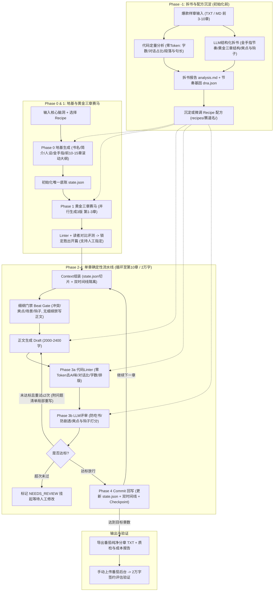

# SilkCanto（锦章）v0.1 设计与开发计划

## 1. 目标与边界

- **项目名称**：锦章 / SilkCanto
- **核心定位**：状态驱动、可批量调度、可人工介入的网文生产 CLI 引擎。
- **v0.1 验证目标**：先通过**拆书**摸清番茄爆款节奏并沉淀配方，再低成本、稳定跑出符合**番茄小说 2 万字（约 10 章）签约评估标准**的样书，导出后手动上传番茄后台验证真实过签率。
- **当前明确不做**：富文本写作 IDE、前端界面、自动发文脚本（均待内容过签验证通过后再按需扩展）。

---

## 2. 技术栈与基础配置（TypeScript）

- **运行环境**：Node.js 22+、TypeScript 5、`pnpm`、`tsx`。
- **核心 SDK 与依赖**：
  - **`ai` + `@ai-sdk/openai-compatible`（Vercel AI SDK）**：统一接入 DeepSeek API（兼容官方端点与中转站，默认模型名配置为 `ds-pro`，支持按阶段路由不同模型），原生提供 `generateText` / `generateObject` 强类型调用与标准 `usage` Token 统计。
  - **`zod`**：唯一底账、拆书基因、细纲、评审结果、配方的强类型 Schema 校验（直接与 Vercel AI SDK 的 `generateObject` 联动）。
  - **`commander` + `cli-table3` + `picocolors`**：CLI 命令解析、多书状态表格与终端高亮输出。
  - **`yaml` + `dotenv`**：Recipe 配方解析与环境变量配置。
  - **`vitest`**：Linter、拆书统计器、底账读写与状态机单元测试。
- **模型路由与成本控制**：
  - `baseUrl`、`apiKey`、默认模型名（`ds-pro`）及按阶段模型覆盖全部通过 `.env` 与 `recipe.yaml` 配置。
  - 每次调用自动落盘 Token 消耗与估算费用到书籍账单。

---

## 3. 全链路流程图



---

## 4. 核心模块详细设计

### 4.1 Phase -1：拆书模块（初始化前先懂赛道）

在创建新书之前，允许导入 1–N 份番茄同赛道参考样章（如热门「都市脑洞」前 3–10 章），用“定量 + 定性”双通道拆解：

- **代码定量分析（零 Token）**：
  - 自动统计每章有效字数、对话占比、平均段落字数、短句率、标点习惯，输出客观数值区间，直接作为后续 Linter 的参考基准。
- **LLM 结构化拆书（`generateObject` + Zod）**：
  - 拆解开篇切入手法、金手指/核心卖点亮相节点、黄金三章情绪曲线（压抑 → 反转 → 反馈 → 钩子）、角色反差模板、章末断章套路与避坑点。
- **产物与复用**：
  - 生成可读报告 `analysis.md`（供人阅读理解赛道规律）与 `dna.json`；
  - 支持直接基于拆书结果生成或更新一套可复用的 `recipes/<name>/` 配方（默认预置 `fanqie_urban_brainhole` 番茄都市脑洞配方）。

### 4.2 文件系统即记忆（唯一底账 + 双时间线）

每本书存放在独立目录 `workspace/books/<book_id>/`，天然支持多书并行。唯一底账 `state.json` 由 Zod 强类型约束：

- **基础设定（`foundation`）**：书名、简介、核心卖点、金手指规则与硬性限制、主线目标。
- **动态角色账本（`characters`）**：姓名、身份、性格锚点、当前状态/处境、与主角关系、已知信息边界。
- **道具与资源账本（`assets`）**：关键物品/资金/能力进度，随章节动态更新。
- **伏笔注册表（`foreshadowing`）**：伏笔 ID、埋设章节、当前状态（`planted` / `progressed` / `resolved`）、预期回收方向。
- **双时间线隔离（防上帝视角剧透）**：
  - `author_truth`：故事中实际发生的全部真相（幕后黑手、隐藏规则、暗线进展）。
  - `reader_known`：截至上一章，主角与读者已经知道的信息。
  - 写正文时显式注入两份清单并约束模型：**禁止角色提前说出或利用未进入 `reader_known` 的信息**。
- **精简上下文组装**：每章开写前，代码按本章细纲从 `state.json` 裁剪相关状态 + 最近 1–2 章正文尾部，避免长篇上下文膨胀。

### 4.3 确定性主管道与断点恢复

主控循环由确定性 TypeScript 代码驱动，每完成一个原子步骤写入 `checkpoints/`，支持随时中断、人工直接编辑本地文件后继续续跑：

1. **Phase 0（地基生成）**：脑洞 + Recipe → 书名/简介/人设/金手指/前 10–15 章滚动卷纲 → 初始化 `state.json`。
2. **Phase 1（黄金三章赛马）**：针对番茄每书仅 1 次 2 万字签约评估机会，并行生成 3 版开篇（第 1–3 章）→ Linter + 读者视角对比优选 → 锁定主线（可人工指定版本）。
3. **Phase 2（单章生成与细纲门禁）**：必须先产出并通过本章细纲（冲突、爽点、场景、章末钩子），无细纲拦截正文生成；通过后生成 2000–2400 字正文。
4. **Phase 3（双层质检与去 AI 味）**：
   - **代码 Linter（零 Token）**：字数区间、对话占比、段落长度上限（适配手机端）、讲义腔/高频 AI 套话词库密度、机械否定排比与破折号滥用；
   - **LLM Critic**：防吃书/OOC、防 `author_truth` 剧透、爽点兑现度、章末钩子强度；
   - 未通过则附具体问题清单局部重写（最多 2 次）；超次则标记 `NEEDS_REVIEW` 挂起等待人工介入。
5. **Phase 4（Commit 状态回写）**：抽取本章事实变动更新 `state.json` 与双时间线，写入 Checkpoint。

### 4.4 多书状态监控与投稿导出

- **多书管理**：`workspace/books/` 下各书完全隔离，CLI 一键汇总查看所有书的阶段、章节进度、挂起告警及 Token 费用。
- **番茄投稿导出**：清洗多余空行与 Markdown 标记，输出可直接粘贴至番茄作家后台的纯净分章 `.txt` + `summary.md`（书名、简介、质检得分与成本账单）。

---

## 5. CLI 命令设计

```bash
# 0. 初始化前：拆解爆款样章，输出分析报告并可选生成 Recipe 配方
silkcanto deconstruct <ref_dir> [--out-recipe fanqie_urban_brainhole]

# 1. 创建新书并生成地基与初始 state.json
silkcanto init <book_id> --idea "一句话核心脑洞" --recipe fanqie_urban_brainhole

# 2. 跑黄金三章多变体赛马（默认生成 3 版前 3 章并输出评审对比）
silkcanto race <book_id> --variants 3

# 3. 锁定采用哪一版开篇，合并入主线并更新底账
silkcanto select <book_id> <variant_id>

# 4. 断点续跑单章流水线至目标章数（如第 10 章 / 2 万字）
silkcanto run <book_id> --to-chapter 10

# 5. 对单章或全书单独运行代码去 AI 味 Linter
silkcanto lint <book_id> [--chapter 4]

# 6. 查看单书或全部书籍的生产进度、挂起告警与 Token 费用
silkcanto status [book_id]

# 7. 导出番茄投稿用纯净分章 TXT 与成本/质检汇总报告
silkcanto export <book_id>
```

---

## 6. 仓库目录结构

```text
novel-maker/
├── plan.md                              # 本计划文档
├── package.json                         # pnpm / TypeScript 项目配置
├── tsconfig.json                        # TypeScript 编译配置
├── vitest.config.ts                     # 单元测试配置
├── .env.example                         # DeepSeek API Key / Base URL / 模型名模板
├── recipes/
│   └── fanqie_urban_brainhole/
│       ├── recipe.yaml                  # 字数、重试次数、模型路由、评分阈值
│       ├── anti_slop.yaml               # 去 AI 味词库与 Linter 统计阈值
│       └── prompts/                     # deconstruct / foundation / beat / draft / critic / commit 模板
├── src/
│   ├── cli.ts                           # Commander CLI 入口
│   ├── config.ts                        # 环境配置与 Recipe 加载校验
│   ├── core/
│   │   ├── llm.ts                       # Vercel AI SDK (DeepSeek/OpenAI兼容) + Token 记账
│   │   └── engine.ts                    # 确定性状态机与 Checkpoint 断点管理
│   ├── memory/
│   │   ├── schema.ts                    # state.json Zod 数据模型
│   │   ├── store.ts                     # 底账读写与可读视图渲染
│   │   └── context.ts                   # 章节上下文切片组装器
│   ├── pipeline/
│   │   ├── deconstruct.ts               # Phase -1: 拆书定量统计 + LLM结构化拆解 + Recipe生成
│   │   ├── foundation.ts                # Phase 0: 地基与初始卷纲生成
│   │   ├── racer.ts                     # Phase 1: 黄金三章赛马与对比评审
│   │   ├── chapter.ts                   # Phase 2: 细纲门禁 + 正文生成 + 局部重写
│   │   ├── linter.ts                    # Phase 3a: 零 Token 确定性去 AI 味 Linter
│   │   ├── critic.ts                    # Phase 3b: LLM 一致性与读者爽点审校
│   │   └── committer.ts                 # Phase 4: 章节事实抽取与底账回写
│   └── exporter.ts                      # 番茄投稿用 TXT 与报告导出
├── tests/                               # Linter、拆书统计、底账读写、状态机单元测试
└── workspace/                           # 本地作品与参考样章目录（.gitignore 忽略）
    ├── references/                      # 待拆书的爆款参考样章
    └── books/
        └── <book_id>/
            ├── state.json               # 唯一事实底账
            ├── checkpoints/             # Step 级断点记录
            ├── race/                    # 黄金三章赛马变体与评审报告
            ├── outlines/                # 卷纲与逐章细纲
            ├── chapters/                # 001_章名.md ...
            ├── reports/                 # 每章 Linter/Critic 报告与成本日志
            └── export/                  # 导出的番茄纯净 TXT 与投稿摘要
```

---

## 7. v0.1 实施里程碑

1. **M1 — TS 工程底座与记忆层**：初始化 `pnpm` + TypeScript + `vitest` 工程、`.env` 配置、Vercel AI SDK（DeepSeek `ds-pro` 兼容路由 + Token 记账）、`state.json` Zod Schema 与读写测试。
2. **M2 — 拆书模块、配方与确定性 Linter**：实现 `deconstruct`（代码定量统计 + LLM 结构化拆书 + 配方生成）、内置 `fanqie_urban_brainhole` 配方与 `anti_slop.yaml`、完成零 Token Linter 及单元测试。
3. **M3 — 地基与黄金三章赛马**：实现 `init`、`race`、`select` 命令，跑通 3 版黄金三章并行生成、自动对比和主线锁定。
4. **M4 — 单章流水线与状态回写**：实现 `run` 命令完整闭环（上下文组装 → 细纲门禁 → 正文 → Linter + Critic 重试/挂起 → Commit 底账回写 + Checkpoint 断点恢复）。
5. **M5 — 状态看板、导出与首书实测**：实现 `status`、`lint`、`export` 命令，用 DeepSeek API 实测拆书并跑通第 1 本 2 万字（10 章）都市脑洞样书导出，交付番茄签约验证。
